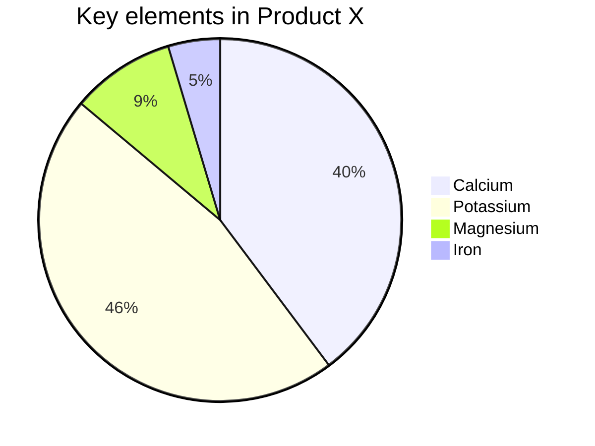

# Mermaid plugin for Typemill

Render [Mermaid diagrams](https://mermaid.js.org/) directly in your Typemill pages. This plugin converts fenced code blocks marked with `mermaid` into live diagrams on your website and can optionally generate static SVG assets for PDF/EPUB export.

## Features

- Render Mermaid diagrams inside Markdown code blocks.
- Choose a Mermaid theme (default, base, dark, forest, neutral).
- Configure security level, font family, and HTML labels.
- Use the bundled Mermaid library or load a specific version from unpkg.com.
- Static SVG export support for PDF/EPUB generators.

## Installation

1. Copy the `mermaid` folder into the `/plugins` directory of your Typemill installation.
2. Log in to the Typemill admin panel.
3. Go to **System → Plugins** and activate the **Mermaid** plugin.
4. Open the plugin settings to configure the rendering options.

## How to use

Switch to the raw editor and create a fenced code block with the `mermaid` language identifier:

On the frontend, the code block is automatically replaced by the rendered diagram.

### Supported diagram types

All diagram types supported by the included Mermaid.js version work, including:

- Flowcharts
- Sequence diagrams
- Gantt charts
- Class diagrams
- State diagrams
- ER diagrams
- Requirement diagrams
- User journey diagrams
- Pie charts
- Git graphs

## Configuration

| Setting | Default | Description |
|---|---|---|
| Mermaid version | bundled | Specific version from unpkg.com, e.g. `10.9.0`. Leave empty to use the bundled library. |
| Theme | `default` | Built-in diagram theme. |
| Security level | `strict` | Trust level for parsed diagrams. |
| HTML labels | `true` | Whether HTML tags are used for edge labels. |
| Font family | empty | Font used for rendered diagrams. |
| Render endpoint | `https://service.typemill.net/mermaid` | Endpoint for static SVG export (PDF/EPUB). |

## Static export (PDF/EPUB)

When Typemill generates a static export, the plugin can replace each Mermaid code block with a cached SVG image. It POSTs the diagram source to the configured render endpoint and stores the returned SVG in `/cache/generated/mermaid/`. If the endpoint is unavailable, a placeholder error SVG is used instead.

## Snapshot

## Changelog

### 2.1.0
- Added static export support for PDF/EPUB generation.
- Added configurable render endpoint for remote SVG generation.
- Hardened JavaScript initialization to prevent broken output from special characters.
- Fixed JavaScript global variable leak in diagram replacement code.
